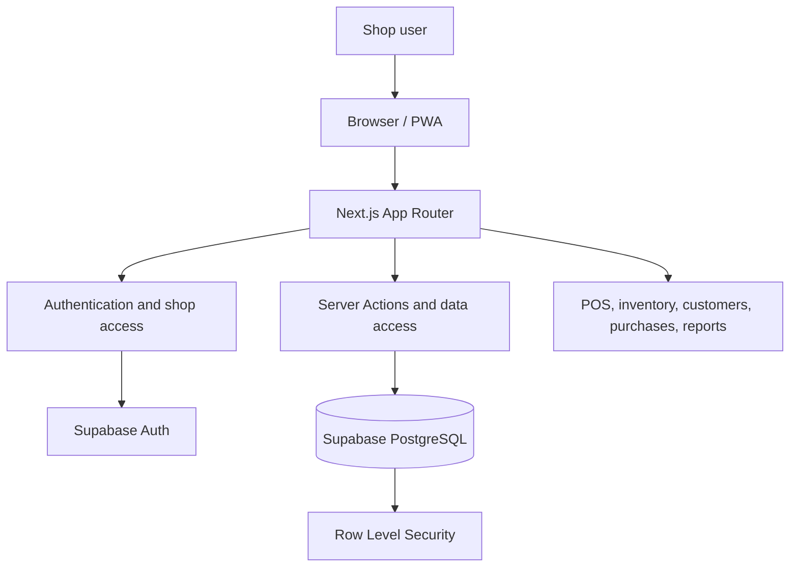

# ShopFlow Architecture

## System context

ShopFlow is a Next.js application for mobile retail operations. The browser communicates with Next.js App Router pages and Server Actions. Server-side application code uses Supabase for authentication and PostgreSQL data access.

## Main application areas

- Authentication and password recovery: `src/app/(auth)/`
- Shop operations and dashboard: `src/app/(dashboard)/`
- Platform administration: `src/app/admin/`
- Shared UI: `src/components/`
- Supabase clients, validation, and application helpers: `src/lib/`
- SQL migrations: `supabase/migrations/`
- PWA assets: `public/`

## Data isolation and trust boundaries

1. A user authenticates through Supabase Auth.
2. Protected application routes enforce shop access before rendering shop operations.
3. Database access is scoped to the authenticated shop.
4. PostgreSQL Row Level Security is an additional enforcement boundary; application filters alone are not a replacement for RLS.
5. The privileged service-role client is server-only and must never be exposed to browser code.

## Operational notes

- Apply migrations in filename order and review them before production rollout.
- Keep environment-specific values outside source control.
- Test tenant isolation with at least two independent shop accounts.
- Validate authorization on every server action that mutates data.
- Confirm backup and restore procedures for the production Supabase project.

## Scope

This document describes the architecture visible in the repository structure and current application entry points. It is not a substitute for a full database threat model or deployment review.
